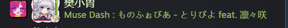

# MuseDashSteamPresence

[English](../README.md) | [简体中文](README.zh-CN.md)

Show your current Muse Dash song in Steam Friends. Supports built-in songs and Euterpe custom charts, optional artist names, custom idle text and separators. Friends do not need this mod.

**[Download mod DLL](https://github.com/Fanxiaowei145/MuseDashSteamPresence/releases/download/v0.5.1-beta.1/MuseDashSteamPresence.dll)** · **[Download full ZIP](https://github.com/Fanxiaowei145/MuseDashSteamPresence/releases/download/v0.5.1-beta.1/MuseDashSteamPresence-0.5.1-beta.1-win-x64.zip)** · [Release page](https://github.com/Fanxiaowei145/MuseDashSteamPresence/releases/tag/v0.5.1-beta.1)

Current version: **0.5.1 Beta**. The links download the files directly. Alternatively, open the release page and choose the DLL or `win-x64.zip` under **Assets**. Use either installation method; the generated **Source code** archives are for developers.

## Preview

| Custom idle text enabled | Artist display enabled |
| --- | --- |
|  |  |

Defaults: `Muse Dash` while idle and `Muse Dash : song title` while playing. Custom idle text and artist display are off by default.

## Installation

Requires **Windows x64, Steam Muse Dash and MelonLoader 0.7.3 net6**.

1. Close the game and download the **mod DLL** above.
2. In Steam, right-click Muse Dash → Manage → Browse local files. Put `MuseDashSteamPresence.dll` in **`Mods`**.
3. Launch the game through Steam once to prepare the bundled settings tool. Start a song to see its title in your status.

If needed, use the [official MelonLoader installer](https://github.com/LavaGang/MelonLoader.Installer/releases/latest) to install loader **0.7.3** for Muse Dash, then launch the game once to initialize it. Euterpe's completed game-environment setup can also install the loader; merely downloading Euterpe does not.

To configure before the first game launch, use the **full ZIP** instead: close the game and extract all contents beside `musedash.exe`, then open the settings tool. [Detailed installation guide, in Chinese](INSTALL.md).

Euterpe Hub installation will be available subject to platform review and listing.

## Settings

Open **`MuseDash-Settings.cmd`** in the game folder, change the options and click **`保存并应用`** (Save and apply). The settings UI is currently Chinese.

- Customize idle text or show only the game name.
- Toggle song titles and artists independently.
- Choose no separator, a space, `_`, or custom text.

The settings app works independently of the game and Euterpe. Saving during gameplay also updates the status. Existing settings are preserved on upgrade. With the game closed, use `MuseDash-Disable.cmd` to disable the mod or `MuseDash-Enable.cmd` to restore it.

## Compatibility

- Reported working across one game-version update; other game versions are not guaranteed.
- Uses private Steam client interfaces. **Only verified Steam DLL builds can publish status**; unsupported builds stop sending. [Compatibility details](COMPATIBILITY.md).
- On the verified client, song changes do not repeatedly trigger new “started playing” notifications. Initial launch may still notify friends normally.
- Long titles and artist names may be truncated. There is currently no guaranteed full-display solution.

The main DLL bundles its own helper, settings app and early plugin, preparing them locally on first launch without extra downloads. It does not modify original game, Steam or other-mod files.

By **樊小胃 / Fanxiaowei145**. Free and open source under [MIT](../LICENSE). [Issues](https://github.com/Fanxiaowei145/MuseDashSteamPresence/issues) and contributions are welcome.

[Build guide](BUILD.md) · [Changelog](../CHANGELOG.md)
